<div align="center">

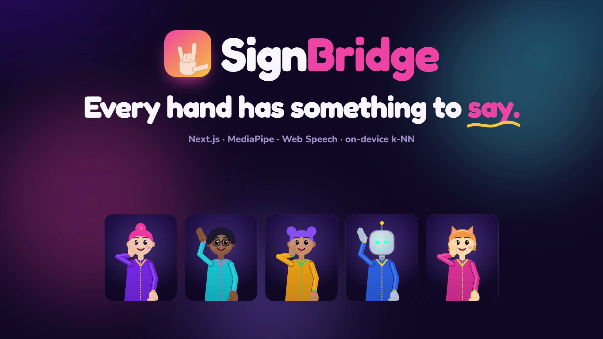

# SignBridge

**Real-time, two-way translation between sign language and speech, with a crew of friendly signing avatars.**

Fingerspell to your webcam and it's spoken aloud. Talk back and an animated buddy signs it to you. Everything runs in the browser.

[](https://signbridge-ruby.vercel.app/)
[](https://nextjs.org)
[](https://react.dev)
[](https://www.typescriptlang.org)
[](https://tailwindcss.com)
[](https://ai.google.dev/edge/mediapipe/solutions/vision/hand_landmarker)
[](https://vercel.com/new/clone?repository-url=https://github.com/Hamzaviour/Sign-Bridge-AI)

**[▶ Try it live](https://signbridge-ruby.vercel.app/)** · [Features](#features) · [Screenshots](#screenshots) · [How it works](#how-it-works) · [Getting started](#getting-started) · [Project structure](#project-structure) · [Roadmap](#roadmap)

</div>

---

## Table of contents

- [About](#about)
- [Features](#features)
- [Screenshots](#screenshots)
- [How to use](#how-to-use)
- [How it works](#how-it-works)
- [Tech stack](#tech-stack)
- [Getting started](#getting-started)
- [Environment variables](#environment-variables)
- [Deploying to Vercel](#deploying-to-vercel)
- [Project structure](#project-structure)
- [Accessibility](#accessibility)
- [Privacy](#privacy)
- [Browser support](#browser-support)
- [Limitations](#limitations)
- [Roadmap](#roadmap)
- [Contributing](#contributing)
- [Author](#author)

---

## About

Around **70 million** deaf people use sign language, but most of the hearing people they meet every day don't. Interpreters are scarce and expensive, so ordinary conversations at a shop, a clinic or a job interview become hard.

SignBridge is a video-call style app that bridges both directions:

- **Sign → speech.** Hand landmarks are tracked from the webcam, classified into letters, cleaned up into a natural sentence and spoken aloud.
- **Speech → sign.** Speech is transcribed into live captions and an animated avatar signs it back, word by word.

It starts with fingerspelling and a library of everyday phrases, and is designed to grow.

<div align="center">
  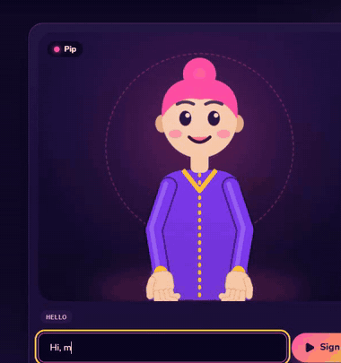
  <br />
  <sub>Type "Hi, my name is Ava": Pip signs HELLO, then fingerspells A-V-A.</sub>
</div>

---

## Features

| | Feature | Details |
|---|---|---|
| ✋ | **Live hand tracking** | 21 landmarks per hand with MediaPipe, drawn as a rainbow skeleton whose glow brightens with confidence |
| 🔤 | **Fingerspelling recognition** | Built-in rules for 13 letters plus an "open hand = space" gesture; hold a letter steady to commit it |
| 🧠 | **Train your own recognizer** | Record samples for any letter; an on-device k-nearest-neighbour model learns your hands. Export / import as JSON |
| 🗣️ | **Gloss to natural English** | Recognised signs (e.g. `ME NAME A-V-A`) are turned into a fluent sentence by an LLM and read aloud, with an offline fallback |
| 🎙️ | **Live captions** | Speech-to-text with large, resizable, high-contrast captions |
| 🧑‍🎨 | **Five signing avatars** | Pip, Kai, Nova, Bolt and Mochi: hand-drawn SVG characters with inverse-kinematics arms, per-finger handshapes, blinking and facial grammar |
| 🤟 | **Sign library** | 20 everyday phrase signs and the full A–Z manual alphabet; unknown words are fingerspelled automatically |
| 🎯 | **Practice mode** | The avatar shows a letter, you copy it on camera and earn XP, levels and streaks (with confetti) |
| 🐢 | **Signing speed control** | Slow the avatar down to 0.5× to follow along |
| ♿ | **Accessible by design** | WCAG AA contrast, keyboard navigation, 44px+ touch targets, reduced-motion support |

---

## Screenshots

### Home: try it without a camera
Type anything and your buddy signs it back. Words become signs; names are fingerspelled.

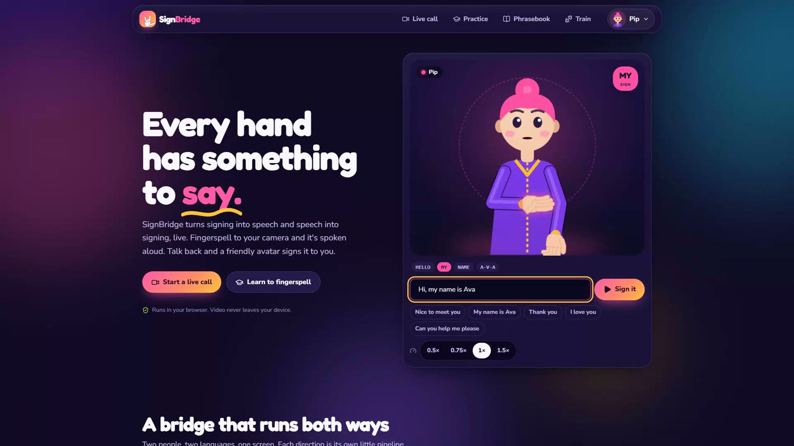

### Pick your signing buddy
Five characters share one sign library. The one you pick follows you across the app.

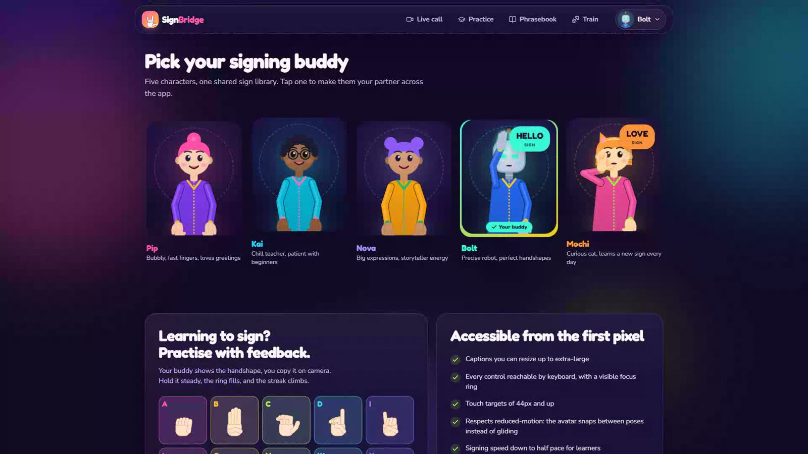

### Live call: speech → sign
Spoken or typed words appear as captions, and each sign lights up as the avatar performs it.

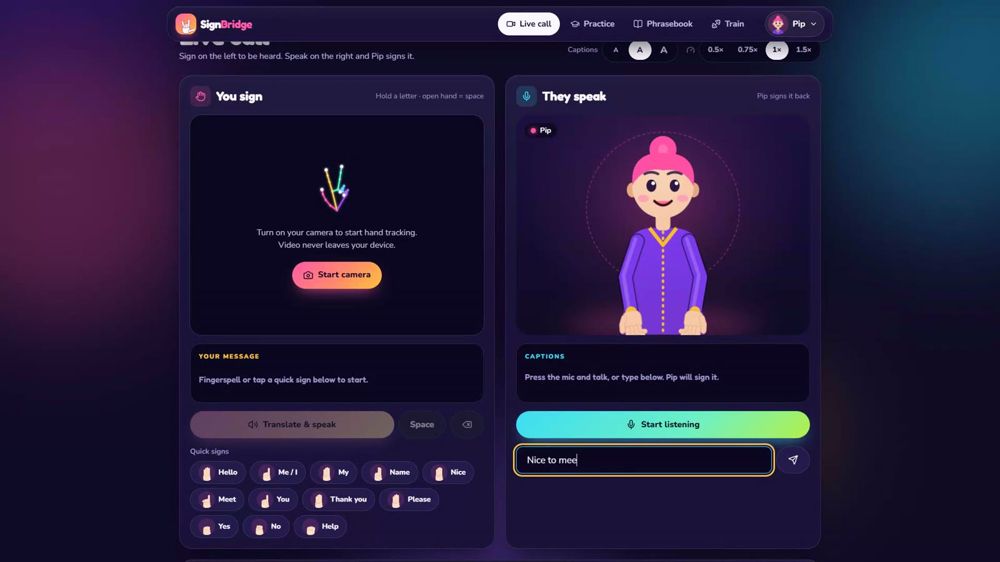

### Live call: sign → speech
Fingerspell or tap quick signs, then **Translate & speak**. The sentence is spoken and logged in the conversation.

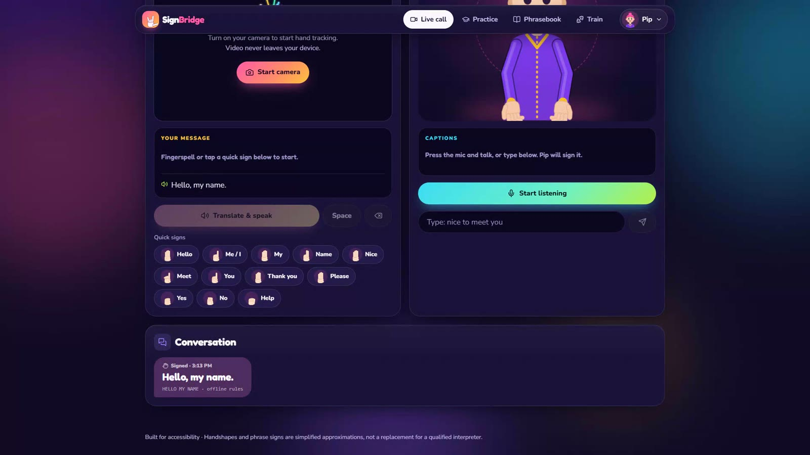

<table>
  <tr>
    <td width="50%">
      <h3>Practice</h3>
      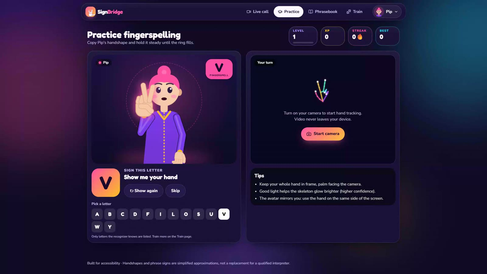
      <p>Copy the handshape, hold it steady, build your streak.</p>
    </td>
    <td width="50%">
      <h3>Train</h3>
      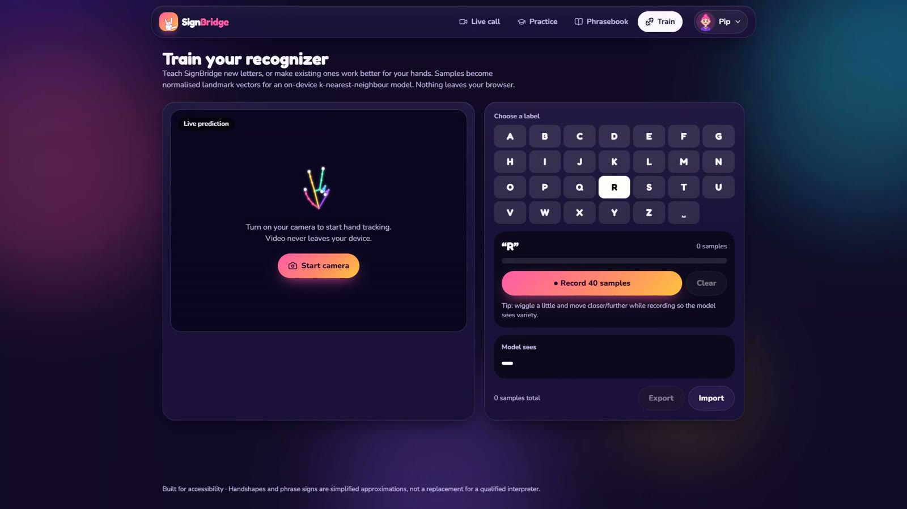
      <p>Record samples to teach the recognizer new letters.</p>
    </td>
  </tr>
  <tr>
    <td width="50%">
      <h3>Phrasebook</h3>
      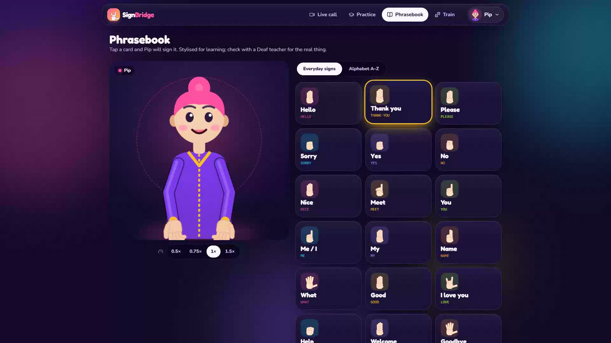
      <p>20 everyday signs, one tap each.</p>
    </td>
    <td width="50%">
      <h3>Alphabet</h3>
      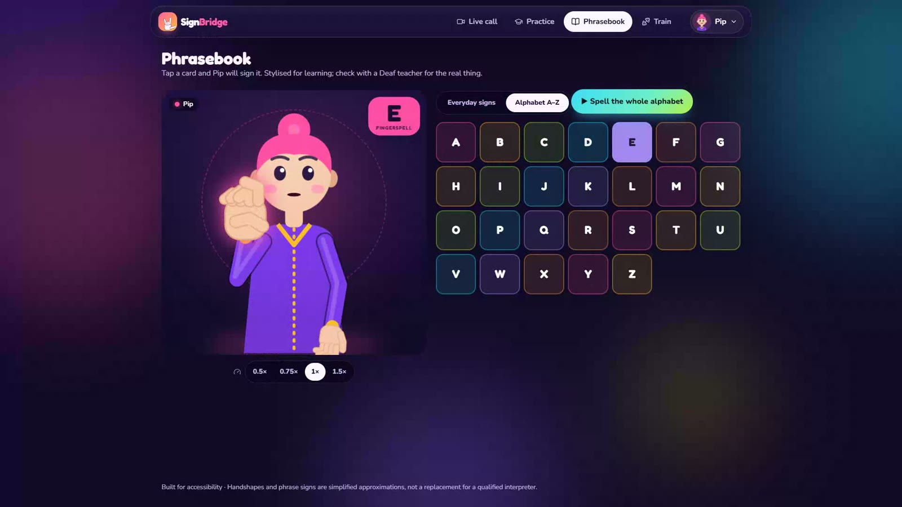
      <p>The full A–Z manual alphabet, or spell it all in one go.</p>
    </td>
  </tr>
</table>

---

## How to use

1. **Pick a buddy.** Use the menu in the top-right corner (or tap a character on the home page).
2. **Open the Live call** (`/call`).
   - **To be heard (signer):** click **Start camera** and allow access. Hold a letter steady until the ring fills and it's added to *Your message*. An open hand adds a space. You can also tap **Quick signs**. Press **Translate & speak**.
   - **To be understood (speaker):** press **Start listening** (Chrome or Edge) or type in the box. The avatar signs it back and the matching signs highlight under the captions.
3. **Practise** at `/practice`: copy the letter the avatar shows. Correct letters earn XP and grow your streak.
4. **Browse** the phrasebook and alphabet at `/learn`.
5. **Teach new letters** at `/train`: choose a letter, press **Record 40 samples**, and move your hand a little while it records.

> **Tips:** keep your whole hand in frame with the palm facing the camera, and use good lighting. The camera is mirrored, so use the hand on the same side of the screen as the avatar's signing hand.

---

## How it works

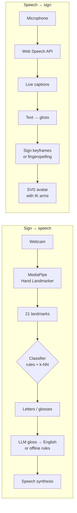

### Sign → speech

1. **Tracking.** `@mediapipe/tasks-vision` runs the Hand Landmarker in `VIDEO` mode on the GPU (falling back to CPU) and returns 21 3D landmarks per hand (`src/lib/handTracker.ts`).
2. **Classification** (`src/lib/classifier.ts`) has two layers:
   - *Geometric rules* measure how curled each finger is, the thumb position and finger spread to recognise **A B C D F I L O S U V W Y** and an open-hand **space**, with no training needed.
   - *k-nearest neighbours* runs over normalised feature vectors: landmarks are centred on the wrist, scaled by palm size, rotated upright and mirrored for left hands. You train it on `/train`; it wins whenever it has a confident match.
3. **Stabilising.** A letter is committed only after it has been held for about 0.65 s with enough confidence, so jitter doesn't type random letters.
4. **Gloss to English.** `POST /api/gloss` sends only the gloss tokens (e.g. `HELLO MY NAME AVA`) to an LLM, which returns one natural sentence. Without an API key, `src/lib/glossFallback.ts` applies simple offline rules instead.
5. **Speech.** The browser's `speechSynthesis` reads the sentence aloud.

### Speech → sign

1. **Captions.** The Web Speech API streams interim and final transcripts (`src/lib/speech.ts`).
2. **Gloss.** `textToGloss` drops filler words, maps known words to library signs and marks the rest for fingerspelling (`src/lib/signs.ts`).
3. **Animation.** Each sign is a list of keyframes giving wrist position, hand rotation and handshape for both hands. `useSignPlayer` interpolates them with easing at 60 fps and supports speed control and reduced motion.
4. **Avatar.** `Avatar.tsx` draws the character as SVG. A two-bone inverse-kinematics solver positions the shoulders, elbows and wrists. Each finger has *curl* and *spread* values, so all 26 letters and every phrase are pure data.

---

## Tech stack

| Layer | Technology |
|---|---|
| Framework | [Next.js 16](https://nextjs.org) (App Router, Turbopack) |
| UI | [React 19](https://react.dev), [TypeScript 5](https://www.typescriptlang.org) |
| Styling | [Tailwind CSS 4](https://tailwindcss.com), CSS custom properties for the design tokens |
| Icons | [Lucide](https://lucide.dev) |
| Fonts | Fredoka (display) and Nunito (body) via `next/font` |
| Hand tracking | [MediaPipe Tasks Vision](https://ai.google.dev/edge/mediapipe/solutions/vision/hand_landmarker) (Hand Landmarker, WASM + GPU) |
| Recognition | Custom geometric rules + in-browser k-NN (no ML framework needed) |
| Language model | [Anthropic API](https://docs.anthropic.com) via `@anthropic-ai/sdk` (optional) |
| Speech | Web Speech API (`SpeechRecognition`, `speechSynthesis`) |
| Sound effects | Web Audio API (synthesised, no audio files) |
| Avatars | Hand-built SVG rig with inverse kinematics, animated with `requestAnimationFrame` |
| Persistence | `localStorage` (preferences, XP, training samples) |
| Hosting | [Vercel](https://vercel.com) |

---

## Getting started

### Prerequisites

- **Node.js 20.9+** (22 or 24 recommended)
- npm
- A webcam for hand tracking, and Chrome or Edge for speech recognition

### Install and run

```bash
git clone https://github.com/Hamzaviour/Sign-Bridge-AI.git
cd Sign-Bridge-AI
npm install
npm run dev
```

Open **http://localhost:3000**, or try the hosted version at **https://signbridge-ruby.vercel.app/**.

### Scripts

| Command | What it does |
|---|---|
| `npm run dev` | Start the development server |
| `npm run build` | Create a production build |
| `npm run start` | Serve the production build |
| `npm run lint` | Run ESLint |

---

## Environment variables

Both variables are **optional**. Without them, the app uses offline rules to turn signs into sentences.

Copy `.env.example` to `.env.local` and fill in:

| Variable | Description |
|---|---|
| `ANTHROPIC_API_KEY` | API key used by `/api/gloss` to turn sign glosses into natural English |
| `LLM_MODEL` | The Anthropic model ID to use |

> `.env.local` is git-ignored. Never commit real keys.

---

## Deploying to Vercel

[](https://vercel.com/new/clone?repository-url=https://github.com/Hamzaviour/Sign-Bridge-AI)

1. Import the repository into Vercel. The framework is detected as **Next.js** (see `vercel.json`).
2. Leave **Root Directory** empty, because the app lives at the repository root.
3. Optionally add `ANTHROPIC_API_KEY` and `LLM_MODEL` under **Settings → Environment Variables**.
4. Deploy. Every push to `main` redeploys automatically.

> The camera and microphone need **HTTPS**, which Vercel provides by default.

---

## Project structure

```text
.
├── docs/                       # README images (banner, screenshots, GIF)
├── public/                     # Static assets
├── src/
│   ├── app/
│   │   ├── api/
│   │   │   └── gloss/route.ts  # POST /api/gloss: sign glosses → English sentence
│   │   ├── call/page.tsx       # Live call: sign ⇄ speech split screen
│   │   ├── learn/page.tsx      # Phrasebook + A–Z alphabet
│   │   ├── practice/page.tsx   # Practice game with XP and streaks
│   │   ├── train/page.tsx      # Record samples for the k-NN recognizer
│   │   ├── globals.css         # Design tokens, buttons, animations
│   │   ├── layout.tsx          # Fonts, navigation, background
│   │   └── page.tsx            # Landing page
│   ├── components/
│   │   ├── Avatar.tsx          # SVG character rig: IK arms, handshapes, face
│   │   ├── AvatarStage.tsx     # Stage around the avatar + current-sign bubble
│   │   ├── Confetti.tsx        # CSS confetti burst
│   │   ├── Crew.tsx            # Buddy picker on the home page
│   │   ├── HandCam.tsx         # Webcam, skeleton overlay, letter stabiliser
│   │   ├── HandGlyph.tsx       # A single drawn handshape (icons, logo)
│   │   ├── HeroDemo.tsx        # "Type anything" demo on the home page
│   │   ├── Logo.tsx            # Logo mark + wordmark
│   │   ├── Nav.tsx             # Top navigation + buddy menu
│   │   ├── SkeletonArt.tsx     # Static hand-skeleton illustration
│   │   └── SpeedControl.tsx    # Signing speed toggle
│   └── lib/
│       ├── characters.ts       # The five avatar characters
│       ├── classifier.ts       # Rule-based + k-NN fingerspelling classifier
│       ├── datasetStore.ts     # Training samples store (localStorage)
│       ├── glossFallback.ts    # Offline gloss → English rules
│       ├── handConnections.ts  # Landmark pairs for the hand skeleton
│       ├── handTracker.ts      # MediaPipe Hand Landmarker loader
│       ├── prefs.ts            # Persisted preferences (buddy, speed, captions)
│       ├── sfx.ts              # Synthesised UI sounds
│       ├── signs.ts            # Handshapes, phrase keyframes, text → gloss
│       ├── speech.ts           # Speech-to-text and text-to-speech helpers
│       └── useSignPlayer.ts    # Keyframe animation player for the avatar
├── .env.example
├── next.config.ts
├── package.json
├── tsconfig.json
└── vercel.json
```

---

## Accessibility

- High-contrast dark theme that meets **WCAG AA**
- Captions with three sizes, up to extra-large
- Every control works with the keyboard and has a visible focus ring
- Touch targets of 44px and up
- `prefers-reduced-motion` is respected: animations stop and the avatar snaps between poses
- `aria-live` regions announce captions, recognised letters and new messages
- Signing speed down to 0.5× for learners

## Privacy

- Video frames are processed **on your device**. No video or audio is uploaded.
- Only the recognised gloss tokens are sent to `/api/gloss`, and only when an API key is configured.
- Training samples, XP and preferences live in your browser's `localStorage` and can be exported or cleared.

## Browser support

| Feature | Chrome / Edge | Firefox | Safari |
|---|---|---|---|
| Avatar signing, phrasebook, practice UI | ✅ | ✅ | ✅ |
| Hand tracking (webcam) | ✅ | ✅ | ✅ |
| Speech recognition | ✅ | ❌ (type instead) | ⚠️ partial |
| Text-to-speech | ✅ | ✅ | ✅ |

## Limitations

- Handshapes and phrase signs are **simplified approximations** for demos and learning. They are not reference-quality ASL and **not a substitute for a qualified interpreter**.
- Out of the box, 13 static letters are recognised. Other letters (including the moving J and Z) need training samples.
- Recognition currently covers fingerspelling, not full sign sentences with movement and grammar.

---

## Roadmap

- [ ] Sequence model for moving signs (J, Z and common words)
- [ ] Larger phrase library and two-handed signs
- [ ] Other sign languages (BSL, PSL)
- [ ] Community-contributed sign recordings
- [ ] WebRTC calls between two devices
- [ ] Mobile app

## Contributing

Contributions, bug reports and feedback are welcome, **especially from Deaf and hard-of-hearing signers**.

1. Fork the repository
2. Create a branch: `git checkout -b feature/my-change`
3. Commit your changes: `git commit -m "Add my change"`
4. Push the branch: `git push origin feature/my-change`
5. Open a pull request

## Author

**Hamza** · [@Hamzaviour](https://github.com/Hamzaviour)

If SignBridge is useful to you, consider giving the repo a ⭐.
